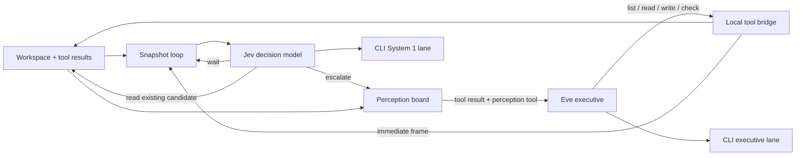

# Two clocks, one workspace

The CLI owns the workspace, System 1 controller, event log, and dashboard. It starts Eve as a local process and uses `eve/client` to invoke its durable executive session. Eve tools call a loopback bridge protected by a random per-run token. Each result is enriched with the perception board before the executive sees it.

System 1 samples at a configured cadence and immediately after tools. There is at most one classification in flight. Timer frames coalesce during tool execution or inference. The snapshot contains the task, a bounded file list, recent tool result, recent read excerpts, and the executive's status. The model chooses an action and a candidate file. Selected-action probability gates execution; it is distinct from provider-specific confidence metadata.

Reflex reads use an existing candidate, the same confined file reader, and a per-run budget. System 1 has no write or shell action. Escalations are deduplicated by the tool result and delivered as evidence. They do not interrupt an in-flight executive call; the executive receives them at its next tool boundary or perception fetch. This avoids mutating a model request that has already started.

Writes and exact text replacements require a prior read and reject changed files. Checks execute the command selected by the user, with a timeout and without model credentials. The reader supports existing text files up to 512KB, with executive reads returning bounded line ranges. It excludes hidden files, dependency/build folders, common credentials, and paths outside the workspace. The local bridge is not an OS sandbox; benchmark runs isolate it and workspace checks in Modal.

## Extension points

- `Classifier` in `src/system1.ts`: replace Jev, tune questions, add labeled evaluation fixtures.
- `Snapshot`: add file diffs, diagnostics, terminal state, or a separate screen perception adapter.
- `Controller`: add priorities, cooldowns, a cost budget, and durable perception state.
- `agent/`: executive instructions and typed Eve tools.
- `DashboardState` and event trace: replay saved runs, compare executive-only vs two-clock behavior.

The [Modal evaluation loop](../evals/README.md) measures solve rate, executive steps, System 1 calls/reflexes, decision latency, token usage, and model cost on fixed SWE-bench tasks. Tool returns carry new observations once instead of repeating the entire board. Unchanged-state suppression and reflex chains are configurable. The replay remains a demonstration, not a benchmark.
